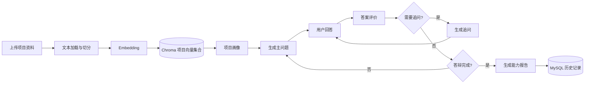

# Reply Agent

一个面向学生项目答辩的 AI 项目理解与能力评测系统。

Reply Agent 不依赖固定题库：用户上传项目说明后，系统通过 RAG 建立项目知识上下文，再由 LangGraph 编排多个 AI 节点，完成项目画像、针对性提问、答案评价、动态追问和最终能力报告。

> 这是一个可公开分享的代码副本。仓库不包含个人简历、邮箱授权码、API Key、数据库文件、向量库、日志、编辑器配置或本机模型文件。

## 功能概览

- **项目资料上传**：支持 TXT / Markdown 文件。
- **项目知识库**：使用文本切分、Embedding 和 Chroma 保存项目级向量集合。
- **智能答辩流程**：基于 LangGraph 管理项目画像、主问题、回答收集、评分、追问和报告节点。
- **结构化 AI 输出**：使用 Pydantic Schema 约束项目画像、问题、评价和报告格式。
- **答辩历史**：使用 MySQL 保存会话、逐题回答、评分与最终总结。
- **语音输入**：通过 WebSocket 接收浏览器 PCM 音频，并使用可选的 Vosk 模型进行识别。
- **Vue 前端**：提供资料上传、实时答辩、语音回答和历史记录页面。

## 工作流



## 技术栈

- **Backend**: Python, FastAPI, Uvicorn
- **Agent workflow**: LangChain, LangGraph, Pydantic
- **RAG**: Chroma, Hugging Face Embeddings, RecursiveCharacterTextSplitter
- **Persistence**: MySQL for history, Chroma for project vectors; `sql/schema.sql` contains the starter schema
- **Speech**: Vosk + WebSocket (optional; configure `VOSK_PATH`)
- **Frontend**: Vue 3, Vite

## 目录结构

```text
Reply_Agent/
├─ app/
│  ├─ ai/
│  │  ├─ agent/multi_agent/   # LangGraph 图、节点、状态和结构化 Schema
│  │  ├─ models/              # 对话模型、Embedding 和语音模型工厂
│  │  ├─ prompt/              # YAML 提示词
│  │  └─ rag/                 # 文档加载、切分、向量存储和检索
│  ├─ common/                 # 基础设施连接
│  ├─ database/repository/    # MySQL 数据访问
│  ├─ service/                # 答辩业务服务
│  └─ web/                    # HTTP / WebSocket 路由
├─ data/
│  └─ test_project.md         # 可公开的示例项目资料
├─ frontend/
│  ├─ src/App.vue             # Vue 页面
│  └─ package.json
├─ .env.example               # 脱敏配置模板
├─ .gitignore
├─ requirements.txt
├─ sql/schema.sql            # MySQL 初始化表结构
└─ README.md
```

运行时生成的 `data/chroma`、`data/uploads`、`data/reports` 和 `logs` 不应提交到 GitHub；应用会按需创建需要的目录。

## 快速开始

### 1. 准备后端环境

建议使用 Python 3.10 或更高版本（当前依赖未对所有 Python 版本组合逐一验证）：

```bash
python -m venv .venv
# Windows
.venv\Scripts\activate
# macOS / Linux
source .venv/bin/activate
pip install -r requirements.txt
```

### 2. 配置环境变量

```bash
copy .env.example .env        # Windows PowerShell 可使用 Copy-Item
# macOS / Linux: cp .env.example .env
```

至少配置一个模型提供方：

- **远程 OpenAI-compatible 模型**：设置 `MODEL_PROVIDER=remote`，填写 `DASHSCOPE_API_KEY`、`MODEL_LINE_NAME` 和 `OPENAI_API_BASE`；或
- **本地 Ollama**：设置 `MODEL_PROVIDER=local`，启动 Ollama，并填写 `OLLAMA_MODEL_NAME` 和 `OLLAMA_BASE_URL`。

Embedding 模型首次使用时可能需要下载；如果运行环境已提前缓存模型，可将 `EMBEDDING_LOCAL_FILES_ONLY=true`。
### 3. 下载模型（由用户自行准备）

本仓库**不包含任何模型权重**，用户需要根据自己的运行方式自行下载：

- **Embedding 模型**：首次启动后，`sentence-transformers` 会根据 `EMBEDDING_MODEL_NAME` 下载并缓存模型；如果机器已经有缓存，可以设置 `EMBEDDING_LOCAL_FILES_ONLY=true`。
- **Ollama 模型**：选择 `MODEL_PROVIDER=local` 后，在本机安装 Ollama，并执行类似 `ollama pull qwen3:1.7b` 的命令准备模型。
- **Vosk 语音模型**：语音功能是可选的。将用户自行下载并解压的 Vosk 模型放入本地目录，例如 `models/vosk-model-cn-0.22`，然后在 `.env` 中配置 `VOSK_PATH`。模型目录由 `.gitignore` 排除，不会上传到 GitHub。

模型下载可能需要网络连接和较大的磁盘空间；请根据模型服务商或模型发布页的说明选择合适的版本。

### 4. 准备 MySQL

当前代码使用两张业务表：`reply_session` 和 `reply_record`。可以直接执行 `sql/schema.sql` 初始化表结构，再在 `.env` 中填写 `MYSQL_*` 配置。数据库连接信息只放在 `.env`，不要写入源码。

### 5. 启动后端

```bash
uvicorn app.main:app --reload
```

健康检查：`GET http://127.0.0.1:8000/api/health`

### 6. 启动前端

```bash
cd frontend
npm install
npm run dev
```

Vite 开发服务器默认运行在 `http://127.0.0.1:5173`，并将 `/api` 与 `/ws` 代理到后端。

## 主要接口

| 方法 | 路径 | 作用 |
|---|---|---|
| `GET` | `/api/health` | 服务健康检查 |
| `POST` | `/api/documents/upload` | 上传项目 TXT / Markdown 资料并写入 Chroma |
| `POST` | `/api/replies/start` | 创建答辩会话并生成第一道问题 |
| `POST` | `/api/replies/{session_id}/answer` | 提交回答并推进答辩流程 |
| `GET` | `/api/replies/history` | 查询用户答辩历史 |
| `GET` | `/api/replies/{session_id}` | 查看单场答辩详情 |
| `DELETE` | `/api/replies/{session_id}` | 删除答辩历史 |
| `WebSocket` | `/ws/voice` | Vosk 语音识别 |

接口的具体请求字段和响应结构以 `app/web` 路由中的 Pydantic 模型为准。

## 安全与公开仓库说明

- `.env` 已被排除，只有 `.env.example` 会进入仓库。
- 不要把 API Key、数据库密码或本地模型目录提交到 GitHub。
- 不要提交真实用户上传资料、答辩历史、Chroma 数据库、SQLite 文件或日志。
- 提交前建议执行一次敏感信息扫描，例如搜索 `D:\\AI_class`、`C:\\Users`、邮箱地址、`sk-`、`password=` 和 `api_key=`。
- 如果某个密钥曾经出现在 Git 历史中，即使现在删除，也应立即在服务商后台轮换该密钥；本副本没有包含原项目的 Git 历史。

## 当前边界

- 公开副本提供 `sql/schema.sql` 初始化表结构，但不包含 Embedding 或 Vosk 模型权重；模型由使用者自行下载。
- LangGraph 当前使用内存 Checkpointer，后端进程重启后未完成的答辩状态不会自动恢复；历史摘要仍由 MySQL 保存。
- 目前 `user_id` 由客户端自行传入，不是身份认证。请勿将此演示版直接部署为公网服务；生产部署须加入服务端认证与授权、限流、上传内容检查、HTTPS / WSS、日志脱敏和密钥管理。

## License

尚未指定开源许可证。公开发布前，请根据你的使用场景补充合适的 LICENSE 文件。